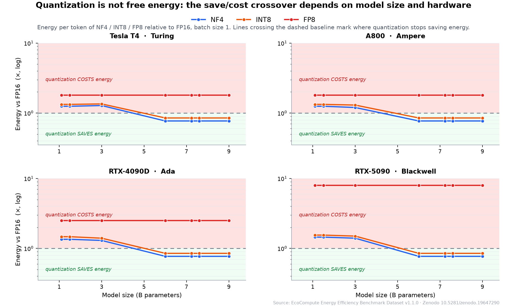

# EcoCompute Energy Methodology — MLCube

[](https://github.com/hongping-zh/ecocompute-mlcube/actions/workflows/ci.yml)
[](https://github.com/hongping-zh/ecocompute-mlcube/issues/29)
[](https://github.com/hongping-zh/ecocompute-mlcube/releases/latest)
[](https://doi.org/10.5281/zenodo.19647290)
[](https://doi.org/10.5281/zenodo.23974825)
[](LICENSE)
[](https://huggingface.co/datasets/hongpingzhang/ecocompute-energy-efficiency)

**Challenge "quantize everything = green" with real energy measurements.**



*NF4 / INT8 / FP8 energy per token relative to FP16 at batch size 1, measured across 4 GPU architectures. Curves above the dashed baseline mean quantization **costs** energy — the crossover where they drop below it moves with model size, hardware, and library version. Data: [EcoCompute Benchmark Dataset v1.1.0](https://doi.org/10.5281/zenodo.19647290).*

360+ configurations across 4 GPU architectures (Turing, Ampere, Ada, Blackwell).  
Run in 3 commands. See where YOUR measurement falls on the crossover curve.

> ⭐ **Star this repo if**: You care about honest energy claims in LLM inference,  
> or want to challenge "quantization always saves power" with real measurements.

---

## What is this?

A **supplemental energy-methodology container** for LLM inference. It measures the *energy* of one configuration — `(GPU × model × precision × batch)` — with direct on-device **NVML** power sampling, and writes an `energy.json` report whose fields align with **MLCommons-style inference energy reporting**.

**This is not a certified benchmark.** It's a reproducible measurement tool that packages the same inputs as the EcoCompute [`/v1/estimate`](https://quantenergy.tech) API as a portable [MLCube](https://mlcommons.org/en/mlcube/)-compatible container.

Every report the CLI emits is machine-checked against Protocol v1.1 (`tools/validate.py`, verdict ladder: `schema-valid` → `protocol-conformant` → `dataset-eligible`). Since [#29](https://github.com/hongping-zh/ecocompute-mlcube/issues/29) the container's own measured reports reach `protocol-conformant` — the validator's rules and the tool's output are in lockstep.

---

## Quick start — 3 commands

```bash
# 1. Download the script from an immutable release
curl -fsSLO https://github.com/hongping-zh/ecocompute-mlcube/releases/download/schema-1.3-r5/quickstart.sh
curl -fsSLO https://github.com/hongping-zh/ecocompute-mlcube/releases/download/schema-1.3-r5/SHA256SUMS

# 2. Verify checksum
sha256sum -c SHA256SUMS

# 3. Run (auto-detects Docker vs native)
bash quickstart.sh
```

**What you get:**
- `ecocompute-out/energy.json` — your measurement (NVML energy, throughput, perplexity)
- A link to overlay your point on the published crossover curve at [quantenergy.tech](https://quantenergy.tech/?tab=run)
- Supply-chain guarantees: checksummed script, non-root container; SBOM release asset (r3; standard again from r6)

**Time:** ~57 minutes first run (downloads), ~2 minutes repeat runs (all cached).

👉 **[Full quickstart guide →](QUICKSTART.md)**

### Batch > 1 (Offline scenario)

The default run is batch 1 (SingleStream). For Offline runs, pass `--batch_size 32` or swap in the ready-made parameter set:

```bash
bash quickstart.sh -- --parameters_file parameters/bert_bs32.yaml
```

Two things change in `energy.json`: `scenario` becomes `Offline`, and the report gains a `tokens_per_run_note` — `tokens_per_run` counts **per sequence**, so each decode iteration generates `tokens_per_run × batch_size` tokens in total (`tokens_generated` records that total; `energy_per_token_mj` is amortized over it).

**Protocol status (deliberate):** batch sizes other than 1 are a protocol §4.8 MAY, labelled separately. `tools/validate.py --profile v1.1-core` will flag `batch_size != 1` (§3.1) — an Offline report can be schema-valid and honest, but it does not qualify for the v1.1-core profile. That is by design, not a gap: the core profile is the comparability floor, Offline runs are supplemental.

---

## Why this matters

### The problem
Most "green AI" claims rest on throughput or memory savings, not energy. A quantization that halves joules but wrecks model quality isn't a win — but without measuring both, you can't tell.

### What we found
- **NF4 crossover is hardware-dependent**: saves energy at 7B on Ada, costs energy at 3B on Blackwell (with bitsandbytes 0.45). The break-even point moved from ~5B to 1.1–1.5B after a library update (bitsandbytes 0.50.2) — **even the version number matters**.
- **INT8 often costs energy**: +55% to +256% on consumer GPUs, with negligible perplexity damage. The problem is speed, not accuracy.
- **FP8 is two different failures**: weight-only degrades with size (+187% to +816%), dynamic-activation degrades the other way (+323% to +83%). Saying "FP8 energy" without naming the code path is meaningless.

### What you can do
1. **Run your own measurement** — 3 commands, any NVIDIA GPU
2. **Compare with published data** — overlay your point on the crossover curve
3. **Submit your replication** — agree or disagree, publish at [quantenergy.tech/replications](https://quantenergy.tech/replications/#submit)

---

## Who uses this?

- **Researchers** validating energy claims before deployment
- **MLOps teams** comparing quantization strategies on their hardware
- **Sustainability auditors** checking "green AI" marketing against measurements
- **Contributors** extending the dataset with independent replications

**Real-world example:** A contributor ran TinyLlama-1.1B NF4 on an RTX 3050 Ti Laptop. The perplexity matched our RTX 4090 measurement to four decimals; the energy number did not — and that contrast is the reason this project exists. → [Submission](https://github.com/hongping-zh/ecocompute-mlcube/issues/15)

---

## Want the decision, not the measurement?

Ask **Watt** — a WorkBuddy expert built on the same measured dataset this container produces. Give it a GPU, a model size and an accuracy target, and it answers whether NF4/INT8 will raise or lower your inference energy, with a provenance label (`measured` / `interpolated` / `estimated`), a confidence rating and the boundary conditions. It says "no data" rather than guessing.

→ **[Ask Watt in WorkBuddy](https://quantenergy.tech/watt/?utm_source=github&utm_medium=readme&utm_campaign=watt-launch&utm_content=ecocompute-mlcube)**

---

## Documentation

| Document | What's in it |
|---|---|
| **[QUICKSTART.md](QUICKSTART.md)** | Complete setup guide, Docker vs native, AutoDL/vast.ai, common overrides, running from source |
| **[TECHNICAL.md](TECHNICAL.md)** | JSON schema, validation, protocol conformance, backend contribution guide, reproducible builds |
| **[docs/backends.md](docs/backends.md)** | How to add llama.cpp, vLLM, or TensorRT-LLM as inference engines |
| **[GPU 能耗测量入门 (Tutorials, 中文) →](https://cloud.tencent.com/developer/column/109571)** | Hands-on article series: from reading watts to a reproducible measurement protocol — continuously updated |

---

## Provenance

- **Tool**: https://quantenergy.tech
- **Paper** (SSRN #6854700): *Weight-Only Quantization Does Not Always Save Energy…* (under review)
- **Container (this repo) software DOI**: `10.5281/zenodo.23974826` (release `schema-1.3-r5`; concept DOI `10.5281/zenodo.23974825` always resolves to the latest version)
- **Main dataset DOI**: `10.5281/zenodo.19647290` (source of no-GPU reference values)
- **RTX 4090 (Ada) deep dive DOI**: `10.5281/zenodo.22037483` (three sessions; the 2026-08-19 one pairs energy with perplexity)
- **RTX 5090 (Blackwell) deep dive DOI**: `10.5281/zenodo.22855133` (four precisions, cross-restart repeatability)
- **Code**: https://github.com/hongping-zh/ecocompute-ai
- **Schema lineage**: the energy-report schema was shaped through public engagement with the MLCommons community on standardizing inference energy metrics ([MLPerf Inference #2558](https://github.com/mlcommons/inference/issues/2558)) — the phase-recording (`measurement.window`) and thermal-state fields in schema 1.3 came out of that exchange

---

## Acknowledgments

- **@gkgoing** — first independent replication (2026-08): TinyLlama-1.1B NF4 on RTX 3050 Ti Laptop. [Submission →](https://github.com/hongping-zh/ecocompute-mlcube/issues/15)
- **@amarjithkumar2007-wq** — AMD GPU (ROCm) detection and fallback (PR #20); context_length applied in measurement path (PR #22); mock-tested ROCm power/temperature telemetry sampler (PR #31) — now co-author on the container's software record.
- **@yesheng-oss** — backend contribution guide (PR #21): documents how to add llama.cpp, vLLM, or TensorRT-LLM.

**How contributors become authors**: the thresholds and the difference between authorship and acknowledgment are defined in the [authorship policy](CONTRIBUTING.md#authorship-policy) — two PRs of substance, or one protocol-conformant data submission accepted into the dataset.

---

## Part of the EcoCompute ecosystem

- **[ecocompute-mlcube](https://github.com/hongping-zh/ecocompute-mlcube)** — Measure energy on YOUR GPU *(this repo)*
- **[quant-energy](https://github.com/hongping-zh/quant-energy)** — Interactive curves + API (deploys [quantenergy.tech](https://quantenergy.tech))
- **[ecocompute-ai](https://github.com/hongping-zh/ecocompute-ai)** — RTX 5090 benchmark suite
- **[ecocompute-action](https://github.com/hongping-zh/hongping-zh-ecocompute-action)** — CI audit for LLM energy waste

→ **[quantenergy.tech](https://quantenergy.tech)** for the full dataset

---

## License

[Apache License 2.0](LICENSE) © 2026 Hongping Zhang. See [`NOTICE`](NOTICE).

---

## Trademarks

MLCOMMONS, MLPERF, and MLCUBE are trademarks of **MLCommons Association**. This project references them **nominatively** only, to describe the energy-reporting methodology and the container format; it does **not** indicate any MLCommons endorsement, certification, or a certified benchmark result.

